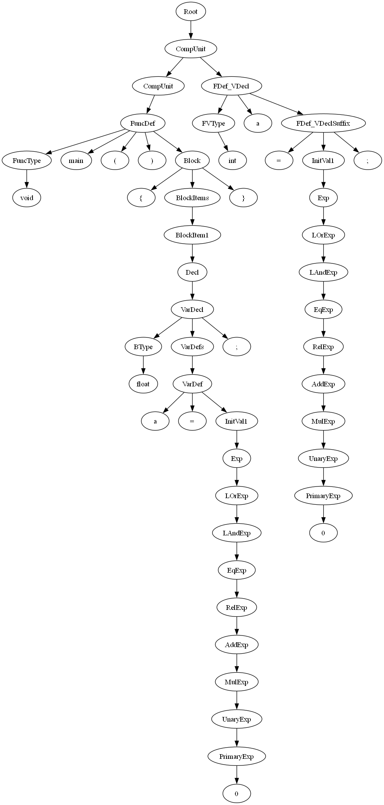

# SysY Compiler

A compiler front end for **SysY** — the C subset used by the national compiler-design
competition (全国大学生计算机系统能力大赛 · 编译系统设计赛). Written in C++17 with Flex + Bison,
producing a typed AST and exporting it as a graph.



*The AST for `hello.c`, dumped as a graph — note the full precedence chain from `LOrExp`
down to `PrimaryExp`, one node per grammar layer.*

---

## Where it stands

Being precise about scope, because "written a compiler" can mean many things:

| Stage | Status | Where |
|---|---|---|
| Lexical analysis | ✅ done | `src/sysy.l` (Flex) |
| Syntax analysis | ✅ done | `src/sysy.y` (Bison, LALR) |
| AST construction | ✅ done — 123 node classes | `src/AST.h`, `src/AST.cpp` |
| AST pretty-print / graph export | ✅ done | `AST::Print` |
| Semantic checking | ⚠️ framework in place, rule coverage thin | `AST::SematicCheck` |
| Koopa IR generation | ❌ only a skeleton | `src/KoopaIR.h` |
| RISC-V assembly | ❌ not started | — |

`main.cpp` says it plainly in its own TODO block:

```cpp
// TODO:
// 中间代码输出
// riscv汇编代码输出
```

and any unrecognised output mode exits with `未知的模式`. So: **this is a front end, not a
complete compiler.** It parses and checks SysY; it does not emit code.

---

## What SysY features it accepts

Declarations

- `int` / `float` types, `const` and non-const
- multi-dimensional arrays, with initializer lists (`{1, 2, 3}`)
- array parameters (`int a[]`, `int a[][3]`)
- global and local variable declarations

Statements

- assignment, expression statements, blocks
- `if` / `else`, `while`, `break`, `continue`, `return`
- function definitions, declarations and calls

Expressions

- full operator precedence: `||` → `&&` → `== !=` → `< > <= >=` → `+ -` → `* / %` → unary
- `+ - !` unary operators, nested calls, parenthesised expressions

The full production list, mapped to the AST node class each production produces, is in
[`README_CN.md`](README_CN.md). That file is the authoritative grammar reference —
this README only summarises it.

---

## Usage

```
compiler <input.sy> [-l <lex-output>] [-s <ast-output>]
```

Output modes come in `mode` + `file` pairs and can be repeated; anything not paired with a
known mode is rejected.

```bash
./build/compiler hello.c -l lex.txt -s ast.txt

# just dump the AST
./build/compiler hello.c -s ast.txt

# lexer output only
./build/compiler hello.c -l lex.txt
```

- `-l` — token stream from the Flex lexer
- `-s` — the AST, printed as a graph description

Exit codes: `0` on success, `1` on parse failure, `-1` on a semantic error or bad arguments.

---

## Building

Requires `clang`, `clang++`, `flex`, `bison`, and GNU make. The Makefile is based on
Matansilver's universal makefile, modified by MaxXing.

```bash
make            # produces build/compiler
make clean
```

`DEBUG=1` (the default) builds with `-g -O0`; `make DEBUG=0` adds `-O2`.

> ⚠️ **Known build snag**: the Makefile still links `-lkoopa` from `$(CDE_LIBRARY_PATH)/native`,
> inherited from the competition's starter template. No source file includes `koopa.h` or calls
> the Koopa C API — the IR is hand-rolled in `src/KoopaIR.h`. On a machine without the CDE
> environment installed, the link step fails on `-lkoopa`. Drop it from `LDFLAGS` and the
> project builds standalone.

---

## Layout

```
src/
├── sysy.l        Flex lexer
├── sysy.y        Bison grammar; builds the AST as it reduces
├── AST.h         AST node declarations (123 classes)
├── AST.cpp       AST construction, Print, SematicCheck
├── KoopaIR.h     Koopa IR node skeletons (not wired into main.cpp yet)
├── SysyType.h    type representation
└── main.cpp      CLI: arg parsing, driver, output modes
Makefile          flex/bison + clang build
hello.c           sample input
hello.png         the AST for hello.c, as a graph
```

The grammar stays as close to the SysY spec's own productions as possible — `CompUnit` is
left-recursive, and every expression precedence level gets its own AST node class rather than
being folded into a generic binary node. That makes the tree wider, but it means the AST shape
mirrors the spec one-to-one, which is what the graph dump above relies on.

---

## Limitations

- **No code generation.** No Koopa IR, no RISC-V. This is the main missing piece.
- **Semantic checking is partial.** The `SematicCheck()` traversal exists on every node and the
  plumbing is there, but rule coverage is thin — the author's own commit message for it reads
  `一些dirty的语义检查`. Missing pieces include most of the required error reporting (undefined
  symbols, redefinitions, type mismatches, misplaced `break`/`continue`) and constant-expression
  evaluation.
- **Only tested on Linux.** Flex / Bison / Clang are assumed; there is no MSVC or Windows path.
- `hello.l` at the repo root is an early standalone lexer experiment, not part of the build
  (the Makefile only picks up `src/*.l`).

---

## License

[MIT](LICENSE)
